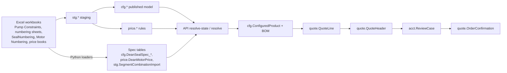
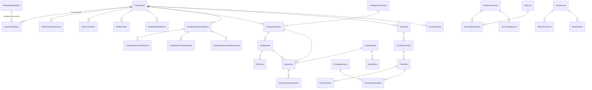
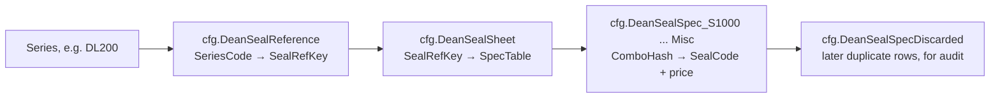

# Database Architecture

**Database:** `PumpConfiguratorDB` (SQL Server). **Snapshot:** 2026-08-26, read from the live database (94 tables, 64 procedures/functions/views). Row counts below are from that snapshot and change as data is reloaded.

The database serves two pump families that share one set of tables, separated by `PumpFamilyId`:

| Family | `cfg.PumpFamily` | Status |
|---|---|---|
| `FYBROC` | `PumpFamilyId = 2` | Frozen. No change may alter its rows. |
| `DEAN` | `PumpFamilyId = 1` | Active development. |

Contents: 1. [Layers and schemas](#1-layers-and-schemas) · 2. [How everything is tied together](#2-how-everything-is-tied-together) · 3. [`cfg`](#3-schema-cfg-configuration-model) · 4. [Spec tables](#4-spec-tables-explained) · 5. [`stg`](#5-schema-stg-staging) · 6. [`price`](#6-schema-price) · 7. [`quote`](#7-schema-quote) · 8. [`acct`](#8-schema-acct-accounts-and-engineering-review) · 9. [`audit`](#9-schema-audit) · 10. [Relationships that are not foreign keys](#10-relationships-that-are-not-foreign-keys) · 11. [Procedures, functions, views](#11-procedures-functions-and-views) · 12. [Conventions](#12-conventions)

---

## 1. Layers and schemas

| Schema | Tables | Role |
|---|---|---|
| `stg` | 21 | **Staging.** Raw extracts from the Excel workbooks, loaded by Python scripts before anything is published. Batch-tracked, re-loadable. |
| `cfg` | 45 | **Configuration model + runtime registry.** What a pump can be (fields, options, constraints, numbering, seal specs) and every configured product / BOM that has been generated. |
| `price` | 7 | **Pricing.** Price books, rules and conditions, the Dean motor price list, and price adjustment history. |
| `quote` | 7 | **Quotes and orders.** Quote headers, lines, parties, customizations, order confirmations. |
| `acct` | 13 | **Accounts and engineering review.** Distributor accounts, users, loyalty tiers, review cases, notifications. |
| `audit` | 1 | **API request log** (`audit.ApiRequest`). |

Data moves in one direction: **workbook → `stg` → `cfg` / `price` (published, read-only at runtime) → API resolves a configuration → `cfg.ConfiguredProduct` + BOM → `quote`**. `acct` wraps the quote with accounts, approvals and engineering review.

---

## 2. How everything is tied together

### 2.1 The big picture

### 2.2 Core relationship diagram (foreign keys)

(Table names are shown without schema for readability; see the sections below for the schema of each.)

### 2.3 What ties the Dean model together, in order

1. **Which pump?** `cfg.PumpModelReference` maps `(SeriesCode, SizeCode)` to a `BaseIdentifier` (`D<A#>`, the first PN segment). 206 Dean models.
2. **What can be chosen?** `cfg.SeriesFieldOption` lists, per `(PumpFamilyId, SeriesCode, SizeCode, FieldCode)`, every selectable `OptionValue`, with `SelectionMarker` (`STD` / `X`) and `IsStandard`.
3. **What combinations are allowed?** `cfg.FeasibleConstraint` (cross-field allow/deny rows, up to 4 legs; field names bridged to `FieldCode` by `cfg.ConstraintFieldMap`), the numbering sheets loaded into `stg.SegmentCombinationImport` (each segment's coded combinations are an allow-list), and, for seals, the per-sheet seal spec tables.
4. **What is the part number?** Each PN segment is looked up from a numbering table: `stg.SegmentCombinationImport` (wet end, impeller options, power frame, baseplate, flush plan, motor frame, motor spec), the trim sub-tables, and `cfg.DeanSealSpec_*` for the seal. `cfg.usp_AssembleConfiguredProduct` concatenates the segments (the API computes the same string in Python as a parity check).
5. **What does it cost?** `price.PriceRule` + `price.PriceCondition` (adders, components), `price.DeanMotorPrice` (motor), and the seal price held in the seal spec table.
6. **What is stored?** `cfg.ConfiguredProduct` (one row per unique configuration signature, with PN and SKU), `cfg.BOMHeader` / `cfg.BOMLine`.
7. **What is quoted?** `quote.QuoteLine` points at the configured product and BOM; `acct.ReviewCase` / `ReviewCaseLine` hold the engineering review of that quote; `quote.OrderConfirmation` is the final order document.

### 2.4 Dean part number and the table behind each segment

`D<A#>-<WetEnd 4>-<Trim 2><ImpOpts 2>-<PowerFrame 4>-<Seal 3|4>-<Flush 2><Barrier 1><Cooling 2>-<MotorFrame 2><Baseplate 2>-<Motor 4>`

| PN segment | Width | Source of the code |
|---|---|---|
| Base identifier `D<A#>` | 4 | `cfg.PumpModelReference.BaseIdentifier` |
| Wet End | 4 | `stg.SegmentCombinationImport` where `SegmentCode='WET_END_OPTIONS'` |
| Impeller Trim | 2 | Trim sub-tables (inch letter + decimal letter), computed, not a combination lookup |
| Impeller Options | 2 | `SegmentCode='IMPELLER_OPTIONS'` |
| Power Frame | 4 | `SegmentCode='POWER_FRAME_OPTIONS'` |
| **Seal** | 3 (4 on `Misc.` and some 3.000" rows) | `cfg.DeanSealSpec_<sheet>` chosen via `cfg.DeanSealReference` → `cfg.DeanSealSheet` |
| Flush Plan | 2 | `SegmentCode='FLUSH_PLAN'` |
| Barrier / Cooling | 1 / 2 | Fixed placeholders (no numbering table yet) |
| Motor Frame | 2 | `SegmentCode='MOTOR_FRAME'` |
| Baseplate | 2 | `SegmentCode='BASEPLATE_OPTIONS'` (`00` when Baseplate Type is NONE) |
| Motor | 4 | `SegmentCode='MOTOR_SPEC'`; priced via `price.DeanMotorPrice` |

Additional Options, Testing and Documentation are resolved but are **not** part-number drivers. A custom selection replaces its segment's code with a minted code from `cfg.CustomSegmentCode` at the same width.

---

## 3. Schema `cfg` (configuration model)

45 tables. Tables marked **(scaffold, empty)** exist in the schema but hold no rows in the current database; the live runtime uses the tables described as active.

### 3.1 Root and publication

| Table | Rows | Purpose | Key columns / relationships |
|---|---|---|---|
| `cfg.PumpFamily` | 2 | The two families. Almost every other table carries `PumpFamilyId`. | PK `PumpFamilyId`; `FamilyCode` (`DEAN`, `FYBROC`) |
| `cfg.MetadataPublication` | 2 | A published, versioned snapshot of metadata. Option, dependency, item and constraint tables are stamped with the publication that produced them. Exactly one is `Active`. | PK `MetadataPublicationId`; `Status`, `ActivatedAt`, `RetiredAt` |
| `cfg.ConfigurationVersion` | 2 | One current configuration version per family (workbook hash, `IsCurrent`). Parent of the numbering model and of every configured product. | FK → `PumpFamily` |
| `cfg.AuditLog` | 427 | Admin/user actions (who did what to which resource). | `Action`, `ResourceType`, `DetailsJson`, `EventAt` |

### 3.2 Fields, options and applicability (active)

| Table | Rows | Purpose | Key columns / relationships |
|---|---|---|---|
| `cfg.SeriesFieldOption` (SFO) | 67,279 | **The option catalogue.** One row per series (and size, for Dean) per field per selectable value. Drives every dropdown. | FK → `PumpFamily`, `MetadataPublication`. `SeriesCode`, `SizeCode`, `FieldCode`, `OptionValue`, `SelectionMarker` (`STD`/`X`), `IsStandard`. Source cell columns trace each row back to the workbook cell. |
| `cfg.AttributeValue` | 532 | Display value → identifier code for attribute-coded fields. Fybroc only (all 532 rows). | FK → `PumpFamily`, `MetadataPublication`. `FieldCode`, `DisplayValue`, `IdentifierCode`, `IsDefault` |
| `cfg.ItemRegistry` | 467 | Items (item codes) per series with the count of fields each applies to. Fybroc only. | `SeriesCode`, `ItemCode`, `ApplicableFieldCount` |
| `cfg.ItemApplicability` | 507 | Which fields apply to which item per series. Fybroc only. | `SeriesCode`, `ItemCode`, `FieldCode` |
| `cfg.PumpModelReference` | 206 | Series + size → base identifier (`D<A#>`). Dean models. | FK → `PumpFamily`, `ConfigurationVersion`. `ModelIdentifier`, `SeriesCode`, `SizeCode`, `BaseIdentifier` |
| `cfg.VocabularyMap` | 117 | Maps a numbering-sheet value to the SFO value that spells it differently, so a selection finds its coded combination. | PK (`FieldCode`, `ComboValue`) → `SFOValue` |

### 3.3 Constraints and dependencies (active)

| Table | Rows | Purpose | Key columns / relationships |
|---|---|---|---|
| `cfg.FeasibleConstraint` | 4,733 | Cross-field allow/deny rows, up to four legs (`Option1..4Field/Value`). 4,487 Fybroc + 246 Dean. `Allowed`, `SeriesApplicability` (`ALL_SERIES` or a scope marker). | `TableName` groups the rows of one constraint table; `PumpFamilyId` (no FK declared) |
| `cfg.ConstraintFieldMap` | 59 | Bridges a constraint's field name to the SFO `FieldCode`. 28 Fybroc + 31 Dean. | PK (`ConstraintFieldName`, `PumpFamilyId`) |
| `cfg.MotorConstraint` | 3,278 | Fybroc-only motor allow-lists (dimension-pair allowed/not allowed). | FK → `PumpFamily`, `MetadataPublication` |
| `cfg.FieldOptionDependency` | 23,752 | Field-option dependency contexts (target field/value valid in a JSON context). Fybroc only. | FK → `PumpFamily`, `MetadataPublication`. `DependencyCode`, `TargetFieldCode`, `ContextJson` |
| `cfg.CombineVariable` | 112 | Key → value pairs used by combine rules (for example HP → RPM). Fybroc only. | `TableName`, `KeyField/Value`, `ValueField/Value` |
| `cfg.CombineValueDomain` | 53 | Value domains for combine tables. Fybroc only. | `TableName`, `AttributeName`, `AttributeValue` |

### 3.4 Identifier numbering model

The part-number numbering sheets are loaded into `stg.SegmentCombinationImport` and read from there at runtime (see [5](#5-schema-stg-staging)). The `cfg` tables below were designed to hold the published form of the same model and are currently empty.

| Table | Rows | Status | Purpose |
|---|---|---|---|
| `cfg.IdentifierSegment` | 0 | scaffold | One row per PN segment (`SegmentCode`, `AssemblyOrder`, `ExpectedWidth`). |
| `cfg.SegmentCombination` | 0 | scaffold | The coded combinations per segment (`CombinationKey` → `SegmentValue`). |
| `cfg.IdentifierFormat` | 0 | scaffold | PN format template per family. |
| `cfg.PartNumberFormat` | 0 | scaffold | PN prefix/separator/suffix per configuration version. |
| `cfg.CustomSegmentCode` | 0 | **active** | Reusable custom codes minted for a custom spec. `FamilyCode`, `SegmentCode`, `Width`, `SpecKey` (hash of normalised spec text), `SegmentValue` (the code), `SpecText`. Written by `cfg.usp_GetOrCreateCustomSegmentCode`. |

### 3.5 Configuration model scaffolding (empty)

`cfg.ConfigSection` → `cfg.ConfigField` → `cfg.ConfigOption`, `cfg.PumpSeries`, `cfg.ConstraintRule` → `cfg.ConstraintCondition` / `cfg.ConstraintAction`. All 0 rows. They form a normalised field/option/rule model (children point at `cfg.ConfigurationVersion`) that the compiler staging tables (`stg.*Candidate`) were meant to publish into. The running system reads `cfg.SeriesFieldOption`, `cfg.FeasibleConstraint` and the numbering sheets instead.

### 3.6 Configured products and BOM (active)

| Table | Rows | Purpose | Relationships |
|---|---|---|---|
| `cfg.ConfiguredProduct` | 1,322 (92 Dean, 1,230 Fybroc) | One row per unique configuration signature: `ConfigurationSignature` (SHA-256 of the canonical configuration), `PartNumber`, `SKUCode`, `CanonicalConfiguration`. Written by `cfg.usp_GetOrCreateConfiguredProduct`, which `cfg.usp_AssembleConfiguredProduct` calls. | FK → `PumpFamily`, `ConfigurationVersion`, `PumpSeries` |
| `cfg.BOMHeader` | 1,232 | A bill of materials version for a configured product, with `BOMSignature` for reuse. | FK → `ConfiguredProduct` |
| `cfg.BOMLine` | 8,343 | Component lines of a BOM (`ComponentCode`, `PartNumber`, `Quantity`, cost). | FK → `BOMHeader` |
| `cfg.ConfiguredProductRegistry` | 8 (all Fybroc) | Alternative registry path (sql/16) that stores selections and segments next to the product: `SelectionHash`, `SelectionsJson`, `SegmentsJson`, the publication/batch IDs it was built from, and a request counter. | FK → `PumpFamily` |
| `cfg.ConfiguredProductSelection` | 328 | The selections of a registry product, one row per field. | FK → `ConfiguredProductRegistry` |
| `cfg.ConfiguredProductSegment` | 80 | The resolved PN segments of a registry product (`SegmentSequence`, `SegmentCode`, `SegmentValue`, `ResolutionType`, `SourceIdsJson`). | FK → `ConfiguredProductRegistry` |
| `cfg.ConfiguredProductRequestAudit` | 19 | Each request that created or re-used a registry product. | FK → `ConfiguredProductRegistry` |

### 3.7 Dean seal tables (spec tables, see [4](#4-spec-tables-explained))

`cfg.DeanSealReference` (37), `cfg.DeanSealSheet` (7), `cfg.DeanSealSpec_S1000 / S1375 / S1750 / S2125 / S2250 / S3000 / Misc` (21,904 each, except `Misc` 183,208), `cfg.DeanSealSpecDiscarded` (564).

---

## 4. Spec tables explained

"Spec tables" are the lookup tables that turn a configuration into a coded value and a price. Each is loaded from a workbook by a Python script and is replaced wholesale on reload.

### 4.1 Seal specs (SealNumbering.xlsx)

| Table | Meaning |
|---|---|
| `cfg.DeanSealReference` | The **Seal Reference Table** from `Pump Constraints` (col 594). 37 rows, one per Dean series: `SeriesCode` → `SealRefKey`. Keys are `1.000" Shafts`, `1.375" Shafts`, `1.750" Shafts`, `2.125" Shafts`, `2.250" Shafts`, `3.000" Shafts`, `Misc.`, and `X` (no sheet; 4 series). Counts per key: 2, 4, 5, 4, 3, 2, 13, 4. |
| `cfg.DeanSealSheet` | Maps each `SealRefKey` to its own table (`SpecTable`) and records whether the sheet has a Gland Gasket column (`HasGasket`, true only for `Misc.`). |
| `cfg.DeanSealSpec_<sheet>` | **One table per permutation sheet**, so permutations of different sheets can never mix (codes such as `001` repeat across sheets). PK = `ComboHash` (SHA-256 of the permutation), so a permutation can exist only once. Columns: `PermutationNo` (re-sequenced 1..N), `ComboKey` (the `*`-joined, lower-cased selection values), `SealCode`, `PriceRaw`, `PriceAmount`, `PriceStatus`, `SourceRow`. `SealCode` and `PermutationNo` are unique. |
| `cfg.DeanSealSpecDiscarded` | Rows dropped because the same permutation (same values in every column) appeared earlier on the sheet. The earlier row is kept; this table records the discarded code, the kept code (`KeptSealCode`) and the source row. 564 rows. |

**Permutation key.** The key is built from the fields below, in this order (Gland Gasket only for `Misc.`): Seal Configuration, Seal Type, Inboard Rotating Face, Inboard Stationary Face, Inboard Elastomer, Outboard Rotating Face, Outboard Stationary Face, Outboard Elastomer, Hydropads, Pumping Ring, Throttle Bushing, Min Flo Bushing, Lantern Ring, Inboard Hardware, Outboard Hardware, Seal Chamber Config, Gland Type, [Gland Gasket], Shaft Sleeve Material. Seal Chamber Config is matched by bore class (`Standard Bore*` → Standard, `Large*Bore` → Large). **Seal Option and Seal Manufacturer are not part of the key and never affect the code.**

**`PriceStatus`:** `PRICED` (numeric `PriceAmount`), `CF` (`C.F.`, call factory), `TBD`, `BLANK`. `CF`, `TBD` and `BLANK` are placeholders that engineering prices when the quote goes to review; the quote shows C/F.

**PN slot values:** a resolved permutation gives its sheet code; no seal configuration field selected gives `000`; some selected but unresolved gives `TBD`.

**Option cascade.** The same tables drive the seal dropdowns: an option is offered only if some permutation on the series' sheet contains it together with every other selected seal field (Seal Type included). Seal fields have no default (`IsStandard = 0` everywhere).

**Options themselves** come from the `Master` sheet of SealNumbering.xlsx and are loaded into `cfg.SeriesFieldOption` (Dean only) by `scripts/load_dean_seal_master.py`. Seal Chamber Config and Seal Option are not on Master and keep their Pump Constraints values.

Loaders: `scripts/load_dean_seal_reference.py` (reference table), `scripts/load_dean_seal_spec.py` (sheet tables + discards, applies `sql/39`), `scripts/load_dean_seal_master.py` (options).

### 4.2 Numbering combinations (`stg.SegmentCombinationImport`)

The numbering workbooks (Wet End, Impeller, Power Frame, Baseplate, Flush Plan, Motor Frame, Motor Numbering for Dean; the Fybroc identifier sheets) all load into one table. A row is `(FamilyCode, SegmentCode, CombinationKey → SegmentValue)`: the `*`-joined option values in the sheet's column order, and the alphanumeric code. `CombinationKeyHash` indexes the lookup. `ExpectedWidth` is the segment's code width. The set of rows for a segment is the **allow-list**: a combination without a row is not buildable. 441,584 rows in 3 batches (`stg.SegmentCombinationImportBatch`): 140,976 Dean, 300,608 Fybroc.

### 4.3 Motor price (`price.DeanMotorPrice`)

34,084 rows, PK `MotorCode` (the 4-character Combined Alphanumeric Code, which is also the `SegmentValue` of the `MOTOR_SPEC` segment). `Amount` is numeric where the workbook gives a price; `IsContactFactory = 1` where it says `C.F.`.

### 4.4 Custom codes (`cfg.CustomSegmentCode`)

When an engineer resolves a custom selection, the spec text is hashed (`SpecKey`) and a code of the segment's width is minted (`SegmentValue`) and stored once, so the same custom spec always gets the same code. The code occupies the segment's slot in the PN, so the PN structure never changes. The link back to the quote is `quote.QuoteLineCustomization.ResolvedCustomCode` / `ResolvedSpecKey`.

### 4.5 Pricing rules (`price.PriceRule` / `price.PriceCondition`)

The general price spec: a rule (`ComponentCode`, `SeriesCode`, `Amount`, `PricingStatus`, `Priority`) fires when all its conditions match (`FieldCode`, `ComparisonOperator`, `ComparisonValue`). See [6](#6-schema-price).

---

## 5. Schema `stg` (staging)

Loaded by Python scripts from the workbooks. Batch tables record source file, expected vs loaded row counts, status and errors, so a load can be checked and repeated.

### 5.1 Active staging tables

| Table | Rows | Purpose | Parent |
|---|---|---|---|
| `stg.SegmentCombinationImportBatch` | 3 | One batch per numbering load (`FamilyCode`, `SourceFile`, `SourceFileHash`, counts, `Status`). | – |
| `stg.SegmentCombinationImport` | 441,584 | The numbering combinations (see 4.2). **Read at runtime.** | `ImportBatchId` → batch |
| `stg.SeriesFieldOptionImportBatch` | 3 | Batch for SFO loads. | – |
| `stg.SeriesFieldOptionImport` | 4,808 | Raw option rows before publication into `cfg.SeriesFieldOption`. | → batch |
| `stg.AttributeValueImportBatch` | 1 | Batch for attribute-value loads. | – |
| `stg.AttributeValueImport` | 266 | Raw display value / identifier code rows (published to `cfg.AttributeValue` by `cfg.usp_PublishAttributeValues`). | → batch |
| `stg.FieldOptionDependencyImportBatch` | 1 | Batch for dependency loads. | – |
| `stg.FieldOptionDependencyImport` | 13,178 | Raw dependency rows before publication into `cfg.FieldOptionDependency`. | → batch |
| `stg.PricingExtract` | 122,470 | Raw price extracts from the price workbooks (component, series, size, option, amount, status, source cell, `ConditionsJson`). Published to `price.PriceRule`/`PriceCondition` by `price.usp_PublishPricingFromStaging`. | `LoadBatchId` (guid, no FK) |

### 5.2 Compiler and raw-import staging (empty)

`stg.CompilerRun` → `stg.ConfigSectionCandidate`, `stg.ConfigFieldCandidate`, `stg.ConfigOptionCandidate`, `stg.ConfigDependencyCandidate`, `stg.ConstraintRuleCandidate`, `stg.SegmentCombinationCandidate`, `stg.ConfigurationModelIssue`, `stg.LegacyInvalidMarkerDiagnostic` (all keyed by `CompilerRunId`); `stg.ImportBatch` → `stg.RawCell`, `stg.ExtractionIssue` (raw cell dump and extraction issues). All 0 rows: they belong to the workbook-compiler path that is not the current load route.

---

## 6. Schema `price`

| Table | Rows | Purpose | Relationships |
|---|---|---|---|
| `price.PriceBook` | 2 | One price book per family (`DEAN_STANDARD`, `FYBROC_STANDARD`; currency). | FK → `cfg.PumpFamily` |
| `price.PriceBookVersion` | 9 | Versions of a book (`EffectiveFrom/To`, `IsCurrent`, source workbook). Queries use the current version. | FK → `PriceBook` |
| `price.PriceRule` | 133,352 | One priced component/option: `ComponentCode` (for example `BASE_PUMP`, `OPTION_ADDER`, `COUPLING`, `BASEPLATE`, `SEAL`, `MOTOR`, `TAILPIPE`), `SeriesCode`, `RuleType` (`LOOKUP`), `Amount`, `PricingStatus` (`found` when priced), `Priority`, source workbook/cell columns. | FK → `PriceBookVersion` |
| `price.PriceCondition` | 540,713 | The conditions of a rule (`FieldCode`, operator, value, `SequenceNo`). A rule applies when all its conditions match the selections. | FK → `PriceRule` |
| `price.PriceAdjustment` | 0 | Header of a bulk percentage adjustment (scope, percent, totals before/after, who/when). | FK → `cfg.PumpFamily` |
| `price.PriceAdjustmentRow` | 0 | Per-rule before/after amounts of an adjustment. | FK → `PriceAdjustment`, `PriceRule` |
| `price.DeanMotorPrice` | 34,084 | Dean motor price spec (see 4.3). | `MotorCode` = `MOTOR_SPEC` segment code (logical) |

A Dean quote price is the sum of: base pump, option adders, coupling/baseplate/shaft-configuration components (all from `PriceRule` + `PriceCondition`), the motor (`DeanMotorPrice`) and the seal (`cfg.DeanSealSpec_<sheet>.PriceAmount`, charged only when Seal Option is Included). A component with no numeric price is returned as C/F.

---

## 7. Schema `quote`

| Table | Rows | Purpose | Relationships |
|---|---|---|---|
| `quote.QuoteHeader` | 6 | A quote: `QuoteNumber`, customer, `SiteCode`, currency, `Status`, expiry, `CreatedBy`. | No FK; the account link is logical (see 10) |
| `quote.QuoteLine` | 2 | A configured pump on a quote: `PartNumber`, `SKU`, `ConfigurationJson`, quantity, `UnitPrice`, `PricingStatus`, `PricingLineage`, publication and price-book versions used. | FK → `QuoteHeader`, `cfg.ConfiguredProduct`, `cfg.BOMHeader` |
| `quote.QuoteLineCustomization` | 0 | A requested change to a line (`Grouping`, `FieldCode`, `RequestedChange`, `RevisionNo`). When engineering resolves it, `ResolvedCustomCode` / `ResolvedSpecKey` / `ResolvedByAppUserId` / `ResolvedAt` are stamped. | FK → `QuoteLine` |
| `quote.QuoteParty` | 0 | Contact and ship-to parties of a quote. | FK → `QuoteHeader` |
| `quote.OrderConfirmation` | 0 | The confirmed order document (`CpqOrderNumber`, confirmed revision, `DocumentJson`). | `QuoteHeaderId`, `ReviewCaseId` (logical) |
| `quote.QuoteTemplate` | 2 | Excel quote template per family. | FK → `cfg.PumpFamily` |
| `quote.QuoteTemplateMapping` | 0 | Maps output keys to Excel cells for a template. | FK → `QuoteTemplate` |

---

## 8. Schema `acct` (accounts and engineering review)

### 8.1 Accounts and identity

| Table | Rows | Purpose | Relationships |
|---|---|---|---|
| `acct.AppUser` | 16 | A person known by identity provider issuer + subject; email, display name. | – |
| `acct.DistributorAccount` | 1 | A distributor company: `Status`, loyalty tier. | FK → `LoyaltyTier`, `AppUser` |
| `acct.AccountMembership` | 1 | A user's membership and role in a distributor account. | FK → `DistributorAccount`, `AppUser` |
| `acct.AccountApplication` | 1 | A distributor account application and its review outcome. | FK → `DistributorAccount`, `AppUser` (submitter, reviewer), `LoyaltyTier` |
| `acct.Address` | 2 | Addresses captured on an application. | FK → `AccountApplication` |
| `acct.LoyaltyTier` | 3 | Tier definitions (`RateBp`, basis points). | – |
| `acct.LoyaltyAssignment` | 1 | History of tier assignments to an account. | FK → `DistributorAccount`, `LoyaltyTier`, `AppUser` |
| `acct.EngineerMembership` | 2 | Engineers by brand and site. | FK → `AppUser` |
| `acct.BrandSiteRouting` | 2 | Which site is responsible for a brand. | – |

### 8.2 Engineering review

| Table | Rows | Purpose | Relationships |
|---|---|---|---|
| `acct.ReviewCase` | 1 | A submitted quote under engineering review: brand, responsible site, `Status`, assignee, revision number, lead time, notes. | FK → `AppUser` (submitter, assignee); `QuoteHeaderId` → `quote.QuoteHeader` (logical) |
| `acct.ReviewCaseLine` | 1 | Per-line review result: `PartNumber`, `PricingStatus`, `ResolvedUnitPrice`, `CustomSpec`, `EngineerNote`. This is where engineering supplies the price for C/F lines. | FK → `ReviewCase`; `QuoteLineId` → `quote.QuoteLine` (logical) |
| `acct.ReviewEvent` | 5 | Event trail of a case (claimed, completed, change requested…). | FK → `ReviewCase` |
| `acct.Notification` | 46 | Notifications to a user or role. | FK → `AppUser` |

---

## 9. Schema `audit`

`audit.ApiRequest` (0 rows): request/response log keyed by `CorrelationId` (endpoint, bodies, status, who).

---

## 10. Relationships that are not foreign keys

Several links are by value, not enforced by a constraint. They are intentional (data is loaded from workbooks and replaced wholesale) but must be kept consistent by the loaders and audits.

| From | To | Join |
|---|---|---|
| `cfg.SeriesFieldOption.SeriesCode`, `SizeCode` | `cfg.PumpModelReference.SeriesCode`, `SizeCode` | Same series/size values |
| `cfg.SeriesFieldOption.FieldCode` | `cfg.ConstraintFieldMap.SFOFieldCode` ← `cfg.FeasibleConstraint.Option*Field` | Constraint field names are mapped to option field codes |
| `cfg.FeasibleConstraint.PumpFamilyId`, `cfg.ConstraintFieldMap.PumpFamilyId`, `cfg.VocabularyMap` | `cfg.PumpFamily` | Family scoping with no FK |
| `cfg.DeanSealReference.SeriesCode` | `cfg.SeriesFieldOption.SeriesCode` | Series that have seal fields |
| `cfg.DeanSealReference.SealRefKey` | `cfg.DeanSealSheet.SealRefKey` | Selects the spec table (`X` has none) |
| `cfg.DeanSealSheet.SpecTable` | `cfg.DeanSealSpec_*` table name | Resolved in code from a fixed whitelist |
| `cfg.DeanSealSpecDiscarded.(SealRefKey, ComboHash)` | `cfg.DeanSealSpec_*.ComboHash` | The retained row of the same permutation |
| `stg.SegmentCombinationImport.SegmentValue` (`MOTOR_SPEC`) | `price.DeanMotorPrice.MotorCode` | Motor code → price |
| `stg.SegmentCombinationImport` (`SegmentCode`, `CombinationKey`) | SFO selections | The PN lookup key is built from the selected option values |
| `cfg.CustomSegmentCode.SegmentValue` | PN segment slot; `quote.QuoteLineCustomization.ResolvedCustomCode` | Minted custom code |
| `price.PriceCondition.FieldCode` | `cfg.SeriesFieldOption.FieldCode` | Condition tested against the selection |
| `price.PriceRule.SeriesCode` | `cfg.SeriesFieldOption.SeriesCode` | Series scoping |
| `quote.QuoteHeader.CreatedBy` | `acct.AppUser` / `acct.AccountMembership` | Ownership is by creating user; the schema has no direct FK to the account |
| `acct.ReviewCase.QuoteHeaderId` | `quote.QuoteHeader.QuoteHeaderId` | One case per submitted quote revision |
| `acct.ReviewCaseLine.QuoteLineId` | `quote.QuoteLine.QuoteLineId` | Line under review |
| `quote.OrderConfirmation.(QuoteHeaderId, ReviewCaseId)` | `quote.QuoteHeader`, `acct.ReviewCase` | The confirmed order |
| `acct.AppUser.AppUserId` | `quote.QuoteLineCustomization.ResolvedByAppUserId`, `acct.ReviewCaseLine.ResolvedByAppUserId` | Who resolved |

---

## 11. Procedures, functions and views

| Schema | Objects | Role |
|---|---|---|
| `cfg` | `usp_AssembleConfiguredProduct` | Builds the PN from pre-resolved segments (Dean branch and Fybroc branch), creates or re-uses the configured product and SKU. |
| | `usp_GetOrCreateConfiguredProduct`, `usp_PersistConfiguredProduct`, `usp_ResolveConfiguredProduct`, `usp_GeneratePartNumber`, `usp_GenerateSKU` | Configured product creation and identifier generation. |
| | `usp_GenerateBOM`, `usp_GetOrCreateBOM`, `usp_GetBOMBySKU` | BOM generation and reuse by signature. |
| | `usp_LookupBySKU`, `usp_LookupBySKU_Registry` | Decode a SKU back to its configuration. |
| | `usp_GetOrCreateCustomSegmentCode`, `usp_ListCustomSegmentCodes`, `usp_ResolveCustomSpec` | Custom code minting and resolution onto quote customizations. |
| | `usp_ListDeanSealReference`, `usp_PublishAttributeValues`, `usp_GetCurrentConfigurationVersion` | Seal reference listing, attribute publication, current version. |
| | `fn_LookupIdentifierCode`, `fn_Base36Encode`, `fn_Base36Decode` | Identifier code lookup and base-36 helpers. |
| | Views `vw_ActiveAttributeValue`, `vw_ConfiguredProduct`, `vw_ConfiguredProductRegistry`, `vw_CurrentConfigurationVersion`, `vw_SegmentCombinationLookup`, `vw_SFOToComboMap` | Read models over the tables above. |
| `price` | `usp_GetConfigurationPrice`, `usp_PublishPricingFromStaging`, `usp_ApplyPriceAdjustment`; view `vw_CurrentPricingRules` | Price lookup, publication from `stg.PricingExtract`, bulk adjustment. |
| `quote` | `usp_CreateQuote`, `usp_GetQuote`, `usp_ListQuotes`, `usp_AddQuoteLine`, `usp_UpdateQuoteLine`, `usp_RemoveQuoteLine`, customization procs (`usp_AddQuoteLineCustomization`, `usp_UpdateQuoteLineCustomization`, `usp_RemoveQuoteLineCustomization`, `usp_ListQuoteCustomizations`, `usp_ListQuoteLineCustomizations`), `usp_UpsertQuoteParty`, `usp_GetQuoteParties`, `usp_ConfirmOrder`, `usp_GetOrderByCase` | Quote lifecycle. |
| `acct` | `usp_SubmitQuoteForReview`, `usp_ClaimReviewCase`, `usp_ResolveReviewCaseLine`, `usp_CompleteReviewCase`, `usp_RequestFurtherReview`, `usp_RequestReviewChanges`, `usp_GetReviewCase`, `usp_ListReviewCases`, `usp_SubmitApplication`, `usp_ReviewApplication`, `usp_GetApplication`, `usp_ListApplications`, `usp_GetMyAccount`, `usp_UpsertAppUser`, `usp_ListNotifications`, `usp_MarkNotificationRead` | Review workflow, accounts, notifications. |
| `stg` | `usp_CreateAttributeImportBatch`, `usp_CompleteAttributeImportBatch`; view `vw_SegmentCombinationImportValidation` | Attribute import batches and numbering validation. |

---

## 12. Conventions

- **Family scoping.** Almost every table has `PumpFamilyId` (or `FamilyCode` in staging). Dean changes are additive and must leave Fybroc row counts unchanged. The audit scripts check these watermarks: non-Dean `cfg.SeriesFieldOption` 3,638; non-Dean `cfg.FeasibleConstraint` 4,487; non-Dean `cfg.ConstraintFieldMap` 28; Fybroc `stg.SegmentCombinationImport` 300,608.
- **Loader scripts replace data.** Workbook-derived tables are cleared and reloaded by `scripts/*.py` (for example `d110_load_dean_config_v01.py` for SFO and constraints, `load_dean_identifier_to_sql.py` for numbering, `load_dean_seal_*.py` for seals). Loaders are idempotent and record source row and cell for traceability.
- **Migrations** live in `sql/` (numbered files, applied by small runner scripts that split on `GO`). `sql/39` defines the per-sheet seal tables; `sql/23` the assembler.
- **Signatures and reuse.** A configuration is identified by a SHA-256 signature of its canonical JSON; the same configuration returns the same product, SKU and BOM.
- **Placeholders.** `C/F` (call factory) is a value placed where a valid value cannot be fetched, never a selectable option. Seal code `TBD` and motor code `0000` are unresolved placeholders.
- **Source of truth for numbers.** Row counts above are a snapshot; for the current numbers query `sys.partitions` or run the audit scripts (`scripts/audit_*.py`, `scripts/run_all_fybroc_audits.py`).
